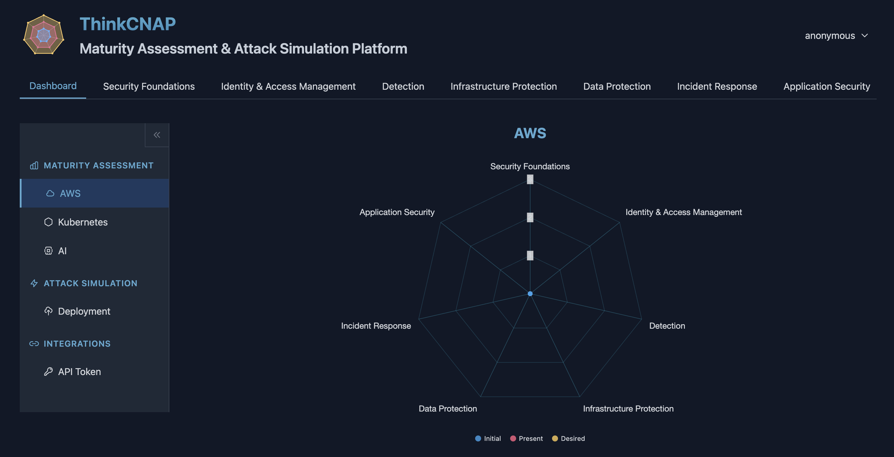

# ThinkCNAP

ThinkCNAP is a security maturity assessment and attack simulation platform for cloud and Kubernetes environments. It helps teams map controls and measures to MITRE techniques, capture current vs desired maturity, and track progress over time. The app provides a structured workflow to assess domains, controls, and measures with consistent scoring. It includes an admin area for managing the security model and data catalog. A built-in dashboard visualizes results to support planning and prioritization. This repository packages the app and database for straightforward Kubernetes deployment.

## Features

- **Maturity assessment** for AWS, Kubernetes and AI workloads across 7 security domains, with Initial / Present / Desired scoring, impact and effort, and MITRE ATT&CK links
- **Attack Simulation**: Helm install guide, a `values.yaml` generator, and a Report view for results sent back by the attack simulation job
- **Integrations API**: per-user API token for reading and updating AWS maturity data from scripts and agents
- **Mobile app**: phones and tablets get a mobile-optimized PWA automatically
- **Anonymous mode**: try the assessment without an account (scores stay in the browser)
- **Admin area** for managing users, domains, controls, measures and MITRE techniques

## Application Preview



## SaaS Version

Looking for a hosted option? The SaaS version is available at https://thinkcnap.org.

## Prerequisites

- Kubernetes cluster (1.19+)
- Helm 3.0+
- `kubectl` configured
- Persistent volume support

## Installation

### 1. Set Required Values

Create a `my-values.yaml` file with required configuration:

```yaml
# Database password (REQUIRED)
database:
  password: "your-secure-password-here"

secrets:
  # JWT secret for signing auth tokens (REQUIRED)
  jwtSecret: "your-strong-jwt-secret"
  # Google OAuth Client ID (optional; empty disables Google Sign-In)
  googleClientId: ""
```

#### Optional: email (verification and password reset)

Without SMTP, users can sign in right after sign-up and the "Forgot Password?" link is hidden; admins can still reset passwords. To enable email verification and self-service password reset:

```yaml
appUrl: "https://thinkcnap.example.com"   # used to build links in emails
smtp:
  host: "smtp.example.com"
  port: 587
  secure: false
  user: "thinkcnap"
  from: "ThinkCNAP <noreply@example.com>"
secrets:
  smtpPassword: "your-smtp-password"
```

### 2. Install the Chart

**From Helm repository:**
```bash
helm repo add think-cnap https://aliaksxssv.github.io/think-cnap
helm repo update
helm install my-think-cnap think-cnap/think-cnap \
  --namespace think-cnap \
  --create-namespace \
  -f my-values.yaml
```

### 3. Access the Application

```bash
kubectl port-forward svc/my-think-cnap 8080:80 -n think-cnap
# Open http://localhost:8080
```

## Upgrading

```bash
helm repo update
helm upgrade my-think-cnap think-cnap/think-cnap -n think-cnap -f my-values.yaml
```

Database migrations run automatically when the app container starts, so existing installs receive new tables and catalog updates (new measures, updated texts) without losing data. Catalog texts you edited in the admin area are not overwritten.

## Attack Simulation Reports

In **Attack Simulation → Settings**, generate a `values.yaml` for the [attack-simulation](https://github.com/aliaksxssv/attack-simulation) chart. It includes your API token (from **Integrations → API Token**) and `REPORT_API_URL`, which points at this instance's `/attack-simulation-report` endpoint. The URL must be reachable from the attack simulation job; when both run in the same cluster you can use the service address, e.g. `http://my-think-cnap.think-cnap.svc/attack-simulation-report`.

## Integrations API

Authenticate with the API token from **Integrations → API Token**:

```bash
# Read AWS maturity data
curl -H "Authorization: Bearer $TOKEN" http://localhost:8080/api/integrations/get-user-aws-maturity

# Update a single measure
curl -X POST -H "Authorization: Bearer $TOKEN" -H "Content-Type: application/json" \
  -d '{"measure_id": "SEC01-BP01-AWS-001", "present_maturity": 2}' \
  http://localhost:8080/api/integrations/update-measure
```

## Default Admin Account

On first database initialization, a default admin user is created:

- Username: `admin@thinkcnap.local`
- Password: `thinkcnap`

Change this after first login.

## Architecture

Single pod with two containers:
- **App Container**: Web application (port 8080)
- **Database Container**: PostgreSQL 16 with automatic migrations and seed data

Shared persistent volume (500Mi default) for database storage.

## Troubleshooting

**Pod Stuck in Pending:**
```bash
kubectl describe pvc -n think-cnap
kubectl get storageclass
```

**Database Not Initialized:**
```bash
kubectl logs <pod-name> -c database -n think-cnap
```

**Application Not Reachable:**
```bash
kubectl get svc -n think-cnap
kubectl port-forward svc/my-think-cnap 8080:80 -n think-cnap
```

**Access Database:**
```bash
POD=$(kubectl get pod -l app.kubernetes.io/name=think-cnap -n think-cnap -o jsonpath='{.items[0].metadata.name}')
kubectl exec -it $POD -c database -n think-cnap -- psql -U thinkcnap -d thinkcnap
```

